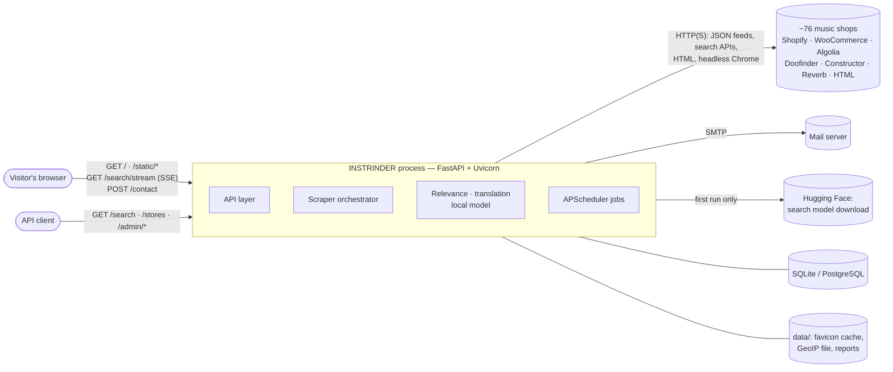
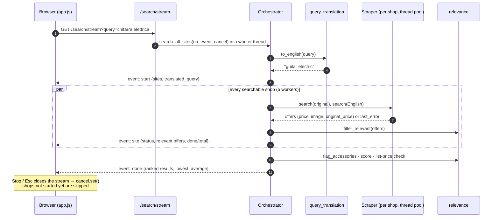
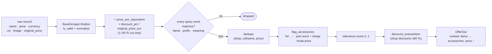

# Architecture

INSTRINDER is a single Python process: a FastAPI application that serves the
web page, the REST API and a Server-Sent Events stream, and runs an optional
APScheduler for periodic jobs. Searching fans out to ~76 shops in a thread
pool; everything else (relevance, translation, ranking) is in-process and
local — no external AI service, no message broker, no separate front-end build.

## System context



## Layers and modules

| Layer | Package | Responsibility |
|-------|---------|----------------|
| Presentation | `api/web/` | page template, 18-language strings, CSS design system, dependency-free JS app |
| API | `api/main.py`, `api/routes/`, `api/schemas.py`, `api/i18n.py` | HTTP endpoints, content negotiation, SSE, contact mail, favicon proxy, page language |
| Orchestration | `scheduler/orchestrator.py` | parallel fan-out, progress events, cancellation, aggregation and ranking |
| Search intelligence | `scrapers/relevance.py`, `scrapers/query_translation.py`, `scrapers/data/` | relevance filter, accessory detection, relevance score, local query translation |
| Scraping | `scrapers/base_scraper.py`, `scrapers/sites/*`, `scrapers/{structured,inline_json,grid,parsers,validator}.py` | one scraper per platform; shared extractors; EUR normalisation and discounts |
| Configuration | `config/` | the 120-shop dataset, probed routes, manual overrides, settings from `.env`, DB engine |
| Jobs | `scheduler/jobs.py` | periodic scrape by priority tier, dataset sync, health checks |
| Domain | `pricing/`, `models/` | suggested price, market analysis, SQLAlchemy models |
| Support | `utils/`, `cache/`, `monitoring/` | JSON logging, rate limiter, currency converter, proxy pool, TTL cache, health checker, Prometheus metrics |
| Tooling | `scripts/` | `probe_stores.py` (route discovery), `test_all_stores.py` (live test) |

Module map:

```
api/
  main.py              app, lifespan (DB init, model warm-up, scheduler), routers,
                       static files, "/" (page or JSON), "/favicon.ico"
  i18n.py              language: ?lang / cookie → country (CDN header or GeoIP) → Accept-Language
  schemas.py           OfferOut, SearchResponse, PricingRequestOffer, PricingResponse
  routes/search.py     /search, /search/stream (SSE), /search-all-sites, /stores
  routes/contact.py    /contact (SMTP, honeypot, per-IP rate limit)
  routes/favicons.py   /favicon/{site_key} (server-side fetch + disk cache)
  routes/admin.py      /admin/* (coverage, status, sync, force scrape, health)
  routes/pricing.py    /pricing        routes/analytics.py  /market-analysis, /price-history
  web/                 index.html, translations.json, static/{app.js, app.css, demo.js, fonts, favicon.svg}
scheduler/
  orchestrator.py      ScraperOrchestrator: _run_site, search_all_sites(on_event, cancel),
                       aggregate_results, _flag_list_price_discounts
  jobs.py              build_scheduler(): scrape_priority(1..3), sync_sites, health checks
scrapers/
  base_scraper.py      session (requests | curl_cffi), rate limit, retries, last_error, finalize
  relevance.py         filter_relevant, flag_accessories, score, local embedding model
  query_translation.py to_english: glossary → embeddings → pass-through
  structured.py        schema.org JSON-LD / microdata   inline_json.py  embedded catalogues
  grid.py              selector-free grid detection      parsers.py      prices, images, names
  validator.py         validation, EUR conversion, discount_pct
  sites/               shopify, woocommerce, reverb, algolia, doofinder, constructor,
                       structured, generic (CSS), playwright (+stealth), thomann; registry
config/
  stores.json          dataset (120 shops)        store_overrides.json  probed routes
  sites_config.py      SITES_CONFIG = dataset ⊕ overrides ⊕ MANUAL_OVERRIDES
  settings.py          pydantic-settings from .env        database.py  engine, sessions
```

## Search: sequence



## Data flow of an offer



## Concurrency and cancellation

- **Across shops**: `ThreadPoolExecutor` (default 5 workers in the API
  orchestrator); scraping is I/O-bound. Each shop runs its original query and,
  for non-English queries, the English one sequentially in the same worker.
- **Per shop**: `RateLimiter` (≥ 10 s between requests to the same domain in the
  default config) — politeness is part of the design, and the main cost of a
  full search.
- **SSE**: the stream endpoint runs the orchestrator in a daemon thread and
  relays events through a `queue.Queue`; a keep-alive comment is sent every
  15 s. Closing the connection sets a `threading.Event`: futures not started
  are cancelled; running scrapers finish their current request.
- **Playwright** runs synchronously inside its worker thread (one browser per
  call); patchright drives Google Chrome for `stealth` shops, or its bundled
  Chromium where Chrome is unavailable.

## Caching and state

| What | Where | Lifetime |
|------|-------|----------|
| Shopify catalogues, collection lists, collection feeds, presentment currency | in-memory TTL cache (`cache/`) | 12 h (`CACHE_TTL_HOURS`) |
| Word embeddings (query and product words) | in-process dict (`relevance._VECTORS`) | process lifetime (bounded) |
| Shop favicons | `data/cache/favicons/` | until deleted |
| Search model | `MODELS_DIR` (default `data/models/`) | downloaded once |
| Contact rate limit | in-process deque per IP | window (`CONTACT_RATE_WINDOW_S`) |
| Search history, theme | visitor's `localStorage` | browser |

All in-process state assumes **one application process** (see
[INFRASTRUCTURE](INFRASTRUCTURE.md#scaling)).

## Error handling

- A shop failing never fails the search: scrapers log and return nothing;
  `BaseScraper.last_error` lets the orchestrator report the shop as `error` in
  the stream (`site` event) and the page lists it as "did not answer".
- Validation rejects offers without a name or a positive price; implausible
  discounts (> 90 % or < 1 %) are dropped, not shown.
- Orchestrator exceptions reach the client as an SSE `error` event; the page
  shows a banner with Retry and keeps the results already received.
- `/contact` maps failures to explicit statuses (422, 429, 502, 503).

## Extension points

- **A new shop**: add it to `config/stores.json`, run `scripts/probe_stores.py`;
  pin a route in `MANUAL_OVERRIDES` if needed (keys in
  [CONFIGURATION](CONFIGURATION.md#manual-overrides)).
- **A new platform or search API**: a `BaseScraper` subclass in
  `scrapers/sites/`, registered in `SCRAPER_TYPES`.
- **A new language**: a block in `api/web/translations.json`; glossary entries in
  `scrapers/data/gear_glossary.json` for query translation.
- **Relevance rules**: `scrapers/relevance.py` (`_ACCESSORY`, `_FOR`, `_WITH`,
  ratios), with self-checks in its `__main__`.
